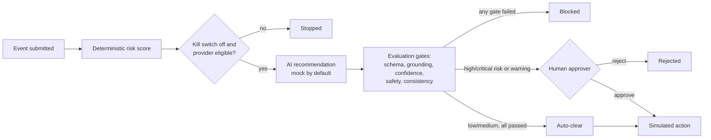
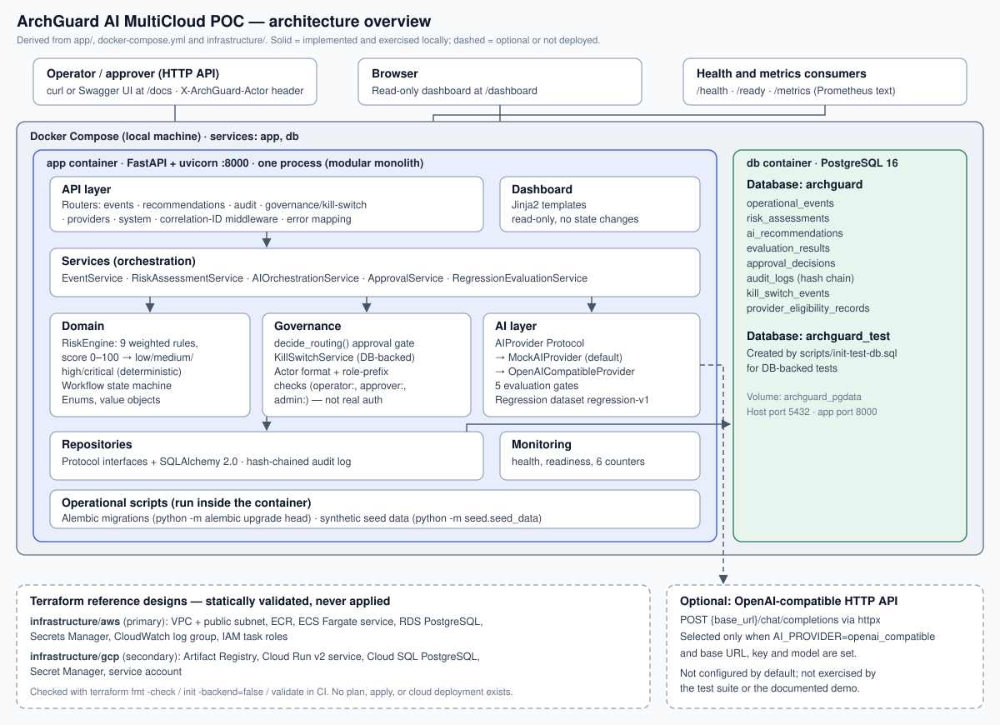

# ArchGuard AI MultiCloud POC

A locally runnable proof-of-concept for AI-assisted incident response in which the AI only
proposes. A deterministic risk engine scores each incident, automated checks evaluate the
AI's recommendation, humans approve at defined risk levels, and every step goes into a
tamper-evident audit log. Actions are simulated, never executed.

**Portfolio category: System Design & Architecture.** A modular-monolith design exercise in
layering, replaceable components, fail-closed control flow, and auditability. It is a POC,
not a production system.

## What, why, how

**What:** a FastAPI + PostgreSQL service that takes an operational event (for example
"elevated 5xx errors on payments in production"), scores its risk, asks an AI provider for a
recommendation, evaluates that recommendation, and routes it to block, human approval, or
auto-clear.

**Why:** AI can suggest an incident response quickly, but "the model said so" is not an
acceptable record for a production change. This project shows a structure where the risk
rating is explainable, AI output is treated as untrusted, unsafe or ungrounded proposals are
blocked automatically, and approvals are attributable.

**How:**



Every step is appended to a hash-chained audit log.



## Implemented capabilities

- Explainable rule-based risk engine (score 0–100, with the rules that fired).
- AI provider behind one interface: a deterministic offline mock (default) and an optional,
  untested OpenAI-compatible client.
- Five evaluation gates. Any failure blocks the recommendation.
- Approval routing with role checks (`approver:` / `admin:` via a demo header, not real
  authentication) and an admin kill switch.
- Regression evaluation required before a provider/model is used.
- Hash-chained audit log with a verification endpoint, plus a read-only dashboard.
- 129 automated tests (unit tests, and PostgreSQL-backed integration, API, security, and e2e
  tests).

Not included: real actions, real authentication, or any cloud deployment. The AWS and GCP
Terraform is a statically validated reference design.


## Quick start

Requires Docker with Docker Compose.

```bash
cp .env.example .env
docker compose up -d --build
docker compose exec app python -m alembic upgrade head
docker compose exec app python -m seed.seed_data
```

Then open http://localhost:8000/dashboard (five seeded scenarios) or
http://localhost:8000/docs (API). Port conflicts, certificate errors during the build, and
running tests are covered in [Demo and Operations](docs/DEMO_AND_OPERATIONS.md).

## Documentation

- [Project Overview](docs/PROJECT_OVERVIEW.md): problem, users, scope, and a worked example.
- [Architecture](docs/ARCHITECTURE.md): components, data and control flow, deployment,
  design tradeoffs, and integration status.
- [Demo and Operations](docs/DEMO_AND_OPERATIONS.md): configuration, startup, demo
  walkthrough, and troubleshooting.
- [Governance and Validation](docs/GOVERNANCE_AND_VALIDATION.md): oversight, authority
  boundaries, security controls, test results, and known limitations.
