# Architecture

## Component responsibilities

| Component | Responsibility | Depends on |
| --- | --- | --- |
| `app/api` | HTTP boundary: routing, Pydantic validation, error mapping, correlation IDs | `app/services`, `app/domain` (enums/exceptions) |
| `app/domain` | Enums, value objects, the deterministic risk engine, the workflow state machine, domain exceptions | nothing else in `app/` |
| `app/services` | Orchestrates use cases (create event, assess risk, request+evaluate AI recommendation, approve/reject, run regression evaluation) | `app/domain`, `app/repositories` (Protocols), `app/ai`, `app/governance` |
| `app/ai/providers` | `AIProvider` Protocol + mock and OpenAI-compatible implementations; returns *untrusted* raw output | `app/domain` (exceptions) only |
| `app/ai/evaluation` | Five independent evaluation gates (schema, grounding, confidence, safety, consistency) + the regression dataset | `app/domain`, `app/ai/providers` (schemas/interfaces) |
| `app/repositories` | `*Repository` Protocols + SQLAlchemy/PostgreSQL implementations | `app/database` |
| `app/database` | SQLAlchemy models, engine/session management | `app/core` (settings) |
| `app/governance` | Kill switch, approval-routing policy (pure function), lightweight identity/authorization | `app/domain`, `app/repositories` (Protocols) |
| `app/monitoring` | Prometheus counters, health/readiness checks | `app/database` (readiness only) |
| `app/dashboard` | Read-only server-rendered views over the same repositories/services | `app/services`, `app/repositories` |
| `app/core` | Settings (env-driven), structured JSON logging with secret redaction | nothing else in `app/` |

## Data flow

The mandatory evaluation-gated flow (spec-required):

```
Input -> Risk Assessment -> AI/Mock Recommendation -> Automated Evaluation
      -> Risk Classification -> Human Approval at Defined Risk Points
      -> Simulated Next Stage or Blocked State
```

Concretely, `AIOrchestrationService.request_and_evaluate()`:

1. Checks the kill switch — blocks immediately if active (before calling any provider).
2. Checks provider eligibility — blocks if no passing regression-evaluation record exists
   for the current provider/model/prompt-version.
3. Calls the configured `AIProvider`, catching `ProviderUnavailableError` and persisting a
   blocked, fully-audited record rather than silently failing.
4. Validates the raw output against a strict Pydantic schema (`AIRecommendationOutputSchema`).
   A schema-invalid response is persisted as blocked; no further gate runs against
   untrusted fields.
5. Runs grounding, confidence, safety, and consistency checks against the validated output.
6. Combines the checks into an overall result and (via `app/governance/approval_gate.py`, a
   pure function) decides: blocked / requires human approval / auto-clear.
7. Persists an `EvaluationResult` row and transitions the event's workflow state
   (`app/domain/workflow.py`) accordingly.
8. Auto-clear and human-approved paths both call `simulate_action()` — a function that
   never touches a real cloud SDK and always returns a payload marked `"simulated": true`.

## Dependency boundaries

- **Domain has zero framework/cloud/AI dependencies.** `app/domain/risk_engine.py` and
  `app/domain/workflow.py` are pure Python, unit-tested without a database or HTTP client.
- **Services depend on repository *Protocols*, not SQLAlchemy.** `app/repositories/interfaces.py`
  defines the contracts; `app/repositories/postgres_repositories.py` is the only module that
  imports SQLAlchemy session/query code for data access.
- **Services depend on the `AIProvider` Protocol, not a concrete provider.** Swapping
  `AI_PROVIDER=openai_compatible` requires no changes to `app/services`, `app/ai/evaluation`,
  or `app/governance`.
- **Governance (kill switch, approval routing, identity) has no AWS/GCP/AI-provider
  imports.** `approval_gate.decide_routing()` is a pure function over enums, directly
  unit-tested.

## OOP decisions

- **Protocols over ABCs** for the three genuine replacement seams (`AIProvider`,
  `*Repository`, implicitly the evaluation functions) — `typing.Protocol` gives structural
  typing without forcing implementers into an inheritance hierarchy, and keeps mocking
  trivial in tests (see `tests/unit/test_evaluation_gates.py`'s `_StableProvider`).
- **No interface for every class.** Risk rules, evaluators, and the workflow state machine
  are plain functions/dataclasses — there is exactly one implementation of each, so an
  interface would add indirection without a replacement seam behind it.
- **Dependency injection via constructor args**, wired at two composition roots:
  `app/api/dependencies.py` (FastAPI `Depends`, per-HTTP-request) and `app/composition.py`
  (plain `Session`, used by the seed script and tests). Both build the same service graph
  from the same Protocols — no logic is duplicated, only the wiring.
- **Value objects are immutable dataclasses** (`RiskScore`, `TriggeredRule`,
  `ConfidenceScore`) with `__post_init__` validation, so an out-of-range score is a
  construction-time error, not a runtime surprise three layers later.

## Vendor-independence strategy

| Boundary | Interface | Swappable without touching | Provider-specific residue |
| --- | --- | --- | --- |
| AI provider | `app/ai/providers/interfaces.py::AIProvider` | risk engine, evaluation gates, approval gate, audit, workflow | Each provider's request/response mapping (`mock_provider.py`, `openai_compatible_provider.py`) |
| Persistence | `app/repositories/interfaces.py` | all services, domain, governance | `app/repositories/postgres_repositories.py`, `app/database/models.py` (PostgreSQL-specific: JSONB, `Identity()`) |
| Cloud infrastructure | none at the app layer — the app is cloud-agnostic (env vars only) | the entire `app/` package | `infrastructure/aws/*.tf` vs `infrastructure/gcp/*.tf` are independent, not templated from a shared module |

**What is honestly *not* portable:** the AWS design uses RDS/ECS/Secrets
Manager/CloudWatch/ECR; the GCP design uses Cloud SQL/Cloud Run/Secret Manager/Cloud
Logging/Artifact Registry. These are different Terraform files with different resource
shapes, not one abstracted module — see `docs/CLOUD_DESIGN.md` for the full shared vs.
provider-specific boundary and why full infrastructure-as-code portability was
deliberately not attempted for a lean POC.

## Trade-offs

- **No ALB in the AWS design; Cloud Run's built-in HTTPS ingress on GCP.** Keeps both
  reference architectures lean at the cost of TLS termination / auth-gateway maturity —
  flagged as a production-hardening gap, not silently omitted.
- **Read-only dashboard.** Avoids duplicating identity/authorization enforcement into an
  HTML form flow; all state changes go through the one authorized API surface.
- **Hash-chained audit log, not cryptographically anchored.** Detects in-place tampering on
  replay (`AuditRepository.verify_chain()`) but doesn't protect against an attacker with
  direct database write access rewriting the whole chain — see `docs/SECURITY.md` for the
  explicit limitation statement.
- **Alembic migration written by hand, not autogenerated**, so it exactly matches the
  ORM models without relying on a live database being reachable during development.

## Architecture diagram

```mermaid
flowchart TD
    Client[API client / dashboard] -->|HTTP| API[app/api routers]
    API --> EventSvc[EventService]
    API --> RiskSvc[RiskAssessmentService]
    API --> AISvc[AIOrchestrationService]
    API --> ApprovalSvc[ApprovalService]
    API --> RegressionSvc[RegressionEvaluationService]

    RiskSvc --> RiskEngine[domain.risk_engine<br/>deterministic, no deps]

    AISvc --> KillSwitch[governance.KillSwitchService]
    AISvc --> Eligibility[(provider_eligibility_records)]
    AISvc --> Provider[ai.providers.AIProvider]
    Provider --> Mock[MockAIProvider<br/>default, no credentials]
    Provider --> OpenAI[OpenAICompatibleProvider<br/>optional]

    AISvc --> Gates[ai.evaluation gates]
    Gates --> Schema[schema_validator]
    Gates --> Grounding[grounding_evaluator]
    Gates --> Confidence[confidence_evaluator]
    Gates --> Safety[safety_evaluator]
    Gates --> Consistency[consistency_evaluator]

    AISvc --> ApprovalGate[governance.approval_gate<br/>pure routing decision]
    ApprovalSvc --> ApprovalGate
    ApprovalGate --> Simulate[services.simulate_action<br/>never calls real infra]

    EventSvc --> Repos[repositories.postgres_repositories]
    RiskSvc --> Repos
    AISvc --> Repos
    ApprovalSvc --> Repos
    RegressionSvc --> Repos
    Repos --> DB[(PostgreSQL)]

    AISvc --> Audit[(hash-chained audit_logs)]
    ApprovalSvc --> Audit
    EventSvc --> Audit
    RiskSvc --> Audit

    Dashboard[app/dashboard] --> Repos
    Metrics[app/monitoring] --> DB
```


