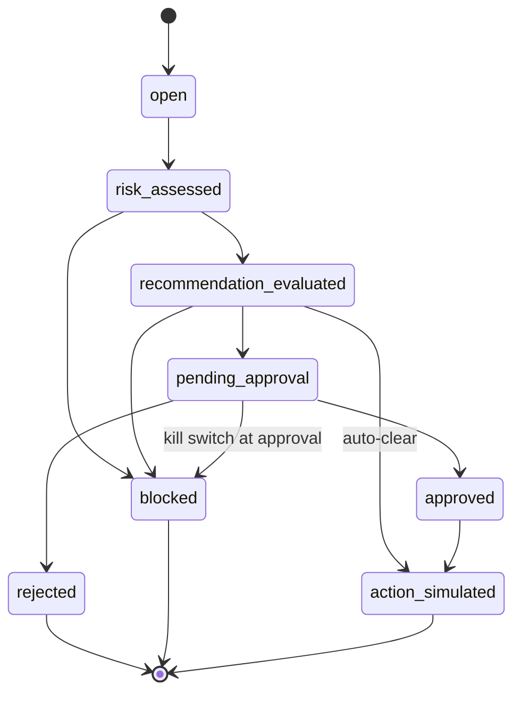

# Architecture

This document describes the system as it is implemented in this repository. Where something
is optional, mocked, or only designed (not deployed), it says so.


## Architectural style

A **modular monolith**: one FastAPI process with strictly layered packages, backed by one
PostgreSQL database. The two places where replacement is a real requirement, the AI provider
and persistence, are expressed as Python `Protocol` interfaces. Everything else is plain
classes and functions.

```text
api / dashboard  →  services  →  domain · governance · ai  →  repositories  →  PostgreSQL
```

`domain/`, `governance/approval_gate.py`, and `ai/evaluation/` do not depend on FastAPI,
SQLAlchemy, or any cloud SDK. This is what lets the core rules run in unit tests without a
database.

## Components

| Package | Responsibility | Key files |
| --- | --- | --- |
| `app/api` | HTTP routers, Pydantic request/response schemas, actor-header dependency, correlation-ID middleware, domain-error → HTTP status mapping | `routers/*.py`, `schemas.py`, `dependencies.py`, `error_handlers.py` |
| `app/dashboard` | Server-rendered, read-only HTML views of events, risk, recommendation, evaluation, approval, and audit trail | `router.py`, `templates/*.html` |
| `app/services` | Use-case orchestration: create events, run risk assessment, request and evaluate AI output, record approvals, run provider regression evaluation, simulate actions | `ai_orchestration_service.py`, `approval_service.py`, `risk_assessment_service.py`, `event_service.py`, `regression_evaluation_service.py`, `action_simulation.py` |
| `app/domain` | Enums, value objects, the deterministic `RiskEngine`, the event state machine, domain exceptions | `risk_engine.py`, `workflow.py`, `enums.py` |
| `app/governance` | Pure routing policy (`decide_routing`), database-backed kill switch, actor format and role-prefix checks | `approval_gate.py`, `kill_switch.py`, `identity.py` |
| `app/ai/providers` | `AIProvider` Protocol, provider factory, deterministic mock, optional OpenAI-compatible client, strict output schema | `interfaces.py`, `factory.py`, `mock_provider.py`, `openai_compatible_provider.py`, `schemas.py` |
| `app/ai/evaluation` | Schema, grounding, confidence, safety, and consistency gates; versioned regression dataset | `*_evaluator.py`, `schema_validator.py`, `regression_dataset.py` |
| `app/repositories` | Repository Protocols and SQLAlchemy implementations, including the hash-chained audit log | `interfaces.py`, `postgres_repositories.py` |
| `app/database` | SQLAlchemy models, engine, request-scoped session (commit on success, rollback on exception) | `models.py`, `session.py` |
| `app/monitoring` | Readiness (database reachability) and six Prometheus counters | `health.py`, `metrics.py` |
| `app/core` | Environment-driven settings, JSON logging with key redaction and correlation IDs | `config.py`, `logging.py` |
| `app/composition.py` | Builds the service graph from a plain session for the seed script and tests | — |
| `migrations/` | Alembic migration `0001_initial_schema` | — |
| `seed/` | Synthetic seed data covering five workflow outcomes | `seed_data.py` |
| `infrastructure/` | Terraform reference designs for AWS and GCP (not applied) | `aws/*.tf`, `gcp/*.tf` |

## Technologies

Python 3.12, FastAPI 0.115, Uvicorn, Pydantic 2 / pydantic-settings, SQLAlchemy 2.0,
Alembic, psycopg 3, PostgreSQL 16, Jinja2, prometheus-client, httpx (used only by the
optional provider), python-json-logger. Tooling: pytest, ruff, Docker / Docker Compose,
Terraform (AWS provider 5.x, Google provider 5.x, pinned by the committed lock files).
Versions are pinned in `requirements.txt` and `requirements-dev.txt`.

## Data model

Eight PostgreSQL tables (migration `0001_initial_schema`):

| Table | Holds |
| --- | --- |
| `operational_events` | Submitted incidents and their current workflow status |
| `risk_assessments` | Score, level, triggered rules (JSONB), explanation, engine version |
| `ai_recommendations` | Provider/model/prompt version, input reference, raw output, parsed fields, status |
| `evaluation_results` | Per-gate results and notes, overall result, risk classification, approval requirement |
| `approval_decisions` | Decision, approver identity, reason (including `system:auto-clear`) |
| `audit_logs` | Append-only entries with `previous_hash` / `record_hash` and a monotonic sequence |
| `kill_switch_events` | History of activate/deactivate changes; latest row is the current state |
| `provider_eligibility_records` | Regression-evaluation results per provider, model, prompt version, dataset version |

## Workflow and routing


The event status machine lives in `app/domain/workflow.py`. Any transition not listed there
raises `InvalidStateTransitionError`, which is returned as HTTP 409.



### Control flow of one recommendation request

`AIOrchestrationService.request_and_evaluate()` is the only code that calls an AI provider.

1. Load the event (it must be `risk_assessed`) and its latest risk assessment.
2. If the kill switch is active, stop with `KillSwitchActiveError` (HTTP 423).
3. If there is no passing eligibility record for the current provider, model, and prompt
   version, stop with `ProviderNotEligibleError` (HTTP 409).
4. Call the provider. If `ProviderUnavailableError` is raised, return HTTP 502.
5. Validate the raw output against `AIRecommendationOutputSchema` (extra fields forbidden).
   If it is invalid, store the recommendation and evaluation as failed and move the event to
   `blocked`.
6. Run grounding, confidence, safety, and consistency checks. The overall result is the
   worst of them. A safety failure raises the risk classification to `critical`.
7. Re-check the kill switch, then call `decide_routing()`:
   - kill switch active or overall `failed` → `blocked`
   - risk `high`/`critical`, overall `warning`, or the AI sets `requires_human_approval` →
     `pending_approval`
   - otherwise → auto-clear: an approval record by `system:auto-clear`, a simulated action,
     and `action_simulated`.

Steps 2–4 write a status change and audit entry and then raise. Through the HTTP API, the
request-scoped session rolls back on any exception, so those writes are discarded and the
event stays `risk_assessed`. This was confirmed against the running stack. The seed script
catches the exception inside its own session, so its provider-failure event is stored as
`blocked`. See [GOVERNANCE_AND_VALIDATION.md](GOVERNANCE_AND_VALIDATION.md#known-limitations).

`ApprovalService.decide()` accepts decisions only for events in `pending_approval`. A
rejection ends in `rejected`. An approval ends in `action_simulated`, or in `blocked` if the
kill switch is active at that moment (the human decision is still stored).

### Risk engine

`RiskEngine` sums the points of the rules that match and caps the total at 100. Levels:
≥75 critical, ≥50 high, ≥25 medium, otherwise low.

| Rule | Points | Condition |
| --- | --- | --- |
| `R-ENV-PROD` | 25 | environment is `production` |
| `R-SEV-CRITICAL` | 30 | reported severity is `critical` |
| `R-SEV-HIGH` | 15 | reported severity is `high` |
| `R-TYPE-SECURITY` | 20 | `security_alert` or `unauthorized_access` |
| `R-TYPE-DATA` | 20 | `data_integrity` |
| `R-TYPE-AVAILABILITY` | 15 | `availability_outage` |
| `R-EVIDENCE-LOW` | 10 | no evidence items |
| `R-SERVICE-CRITICAL` | 15 | service in {payments, auth, authentication, database, billing, identity} |
| `R-KEYWORD-DANGER` | 10 | description contains a sensitive keyword (e.g. "credential", "breach") |

## Deployment structure

**Implemented and verified locally:** Docker Compose with two services.

- `app`: built from `Dockerfile` (python:3.12-slim, non-root user `archguard`, healthcheck on
  `/health`), served by Uvicorn on port 8000. Migrations and seeding are run manually with
  `docker compose exec`.
- `db`: `postgres:16-alpine` on port 5432 with a named volume. On first initialization
  `scripts/init-test-db.sql` creates a second database, `archguard_test`, for the
  DB-backed tests.

**Designed but not deployed:** two independent Terraform trees.

| Concern | AWS (`infrastructure/aws`, primary) | GCP (`infrastructure/gcp`, secondary) |
| --- | --- | --- |
| Image registry | ECR (with lifecycle policy) | Artifact Registry |
| Compute | ECS cluster + Fargate service (1 task) | Cloud Run v2 service |
| Database | RDS PostgreSQL (`publicly_accessible = false`) | Cloud SQL PostgreSQL (public IP enabled, no authorized networks configured) |
| Secrets | Secrets Manager | Secret Manager |
| Logging | CloudWatch log group | No explicit logging resource (Cloud Run platform default) |
| Network / identity | VPC, public subnet, internet gateway, security groups, IAM task roles, task gets a public IP | Service account, `roles/run.invoker` granted to `allUsers` |

Both trees are checked in CI with `fmt -check`, `init -backend=false`, and `validate`. No
`plan` or `apply` has been run, and no cloud resources exist. Several settings are explicitly
POC-only: public subnets, `0.0.0.0/0` ingress on the app port, `deletion_protection = false`,
and public Cloud Run ingress.

## Key design decisions and tradeoffs

| Decision | Why | Tradeoff |
| --- | --- | --- |
| Modular monolith instead of services | One deployable, simple local runtime, clear package boundaries are enough at this size | Components cannot be scaled or deployed independently |
| Deterministic risk engine kept separate from AI | Risk is explainable, testable, and still available when the AI provider is down | The rules are a small hand-written set, not a learned or configurable model |
| AI output treated as untrusted until it passes the gates | A malformed, ungrounded, or dangerous suggestion never reaches routing as a valid recommendation | The gates are heuristics. Grounding is substring matching, consistency is one repeat call |
| Pure `decide_routing()` function | The policy that matters most is one small, directly unit-tested function | Policy changes require a code change, not configuration |
| Deterministic mock provider by default | The whole system runs offline, and the consistency check has stable behavior to test | Says nothing about how a real model would behave |
| Regression gate before a provider is used | A provider or model change must show evidence before it is trusted | The dataset has four cases, so a pass is a minimum bar, not assurance |
| PostgreSQL only, never SQLite for tests | JSONB, identity columns, and check constraints are tested as they run | DB-backed tests need a running PostgreSQL |
| Hash-chained audit log in the same database | Out-of-band edits or deletions are detectable via `/audit/verify` | Anyone who can rewrite the whole table can recompute the chain; it is tamper-evident, not tamper-proof |
| Read-only dashboard | Authorization stays in one place (the API) | All actions go through curl or `/docs` |
| Two Terraform trees instead of one abstraction | Each cloud uses its own idiomatic services; differences stay visible | Duplicate effort; portability is shown at the application level, not the infrastructure level |

The individual decision records are in [`adr/`](adr/).

## Integration status

| Integration | Status |
| --- | --- |
| PostgreSQL | Working. Used by the app, migrations, seed script, and 68 DB-backed tests |
| Mock AI provider | Working, the default. Deterministic, with trigger keywords for failure paths |
| OpenAI-compatible provider | Implemented (`httpx` POST to `{base_url}/chat/completions`). Not configured by default, not covered by tests, and not run for this documentation. It would also need a passing regression evaluation before use |
| Prometheus | `/metrics` exposes counters in Prometheus text format. No Prometheus server or dashboards are included |
| AWS / GCP | Terraform only, statically validated, never applied |
| Paging, ticketing, SIEM, cloud control APIs | None. Event `source` values are labels; simulated actions call nothing |
| CI | GitHub Actions (`.github/workflows/ci.yml`): ruff, migrations, all test suites against a PostgreSQL service, Docker build, Terraform static checks |
