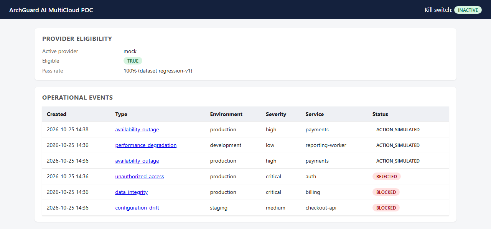

# Demo and Operations

How to configure, start, demo, and troubleshoot the project locally. Every command here was
run while preparing this documentation, except where a step is marked as not verified.

## Prerequisites

| Requirement | Needed for | Notes |
| --- | --- | --- |
| Docker with Docker Compose v2 | Running the app and PostgreSQL | Verified with Docker 29.9 / Compose v5.6 |
| Network access to Docker Hub and PyPI | First image build | See [troubleshooting](#troubleshooting) if TLS is intercepted |
| Python 3.12 | Running tests, lint, or the app on the host | Not needed for the Docker-only path |
| Terraform ~1.9+ | Optional static checks of `infrastructure/` | Needs access to registry.terraform.io for `init` |

No cloud account, AI API key, or other credential is needed.

## Configuration

Settings are read from environment variables (and a `.env` file) by `app/core/config.py`.
Start from the template:

```bash
cp .env.example .env
```

`docker-compose.yml` loads `.env` into the app container, so the file must exist. The
defaults work as they are. Only placeholder values are committed; never commit a real `.env`.

| Variable | Default | Effect |
| --- | --- | --- |
| `DATABASE_URL` | points at host `db` (the compose service) | Compose overrides it for the app container; set it to `localhost` when running on the host |
| `POSTGRES_DB`, `POSTGRES_USER`, `POSTGRES_PASSWORD` | `archguard`, `archguard`, local placeholder | Used by the `db` container and the app's connection string |
| `AI_PROVIDER` | `mock` | `mock` or `openai_compatible` |
| `AI_MODEL_NAME`, `AI_PROMPT_VERSION` | `archguard-mock-v1`, `v1` | Key for the provider eligibility record |
| `OPENAI_COMPATIBLE_BASE_URL`, `_API_KEY`, `_MODEL` | empty | Only used when `AI_PROVIDER=openai_compatible` (not verified here) |
| `EVAL_MIN_CONFIDENCE` | `0.55` | Below this, confidence is a WARNING (human review); below 0.20 it fails |
| `EVAL_CONSISTENCY_RUNS` | `2` | Total provider calls per recommendation (one repeat for the consistency check) |
| `LOG_LEVEL` | `INFO` | JSON logs to stdout |
| `CORRELATION_ID_HEADER` | `X-Correlation-ID` | Echoed on every response |

`.env.example` also lists `APP_HOST`, `APP_PORT`, `APPROVAL_HEADER_NAME`,
`KILL_SWITCH_DEFAULT_STATE`, and `METRICS_ENABLED`. They are loaded into settings, but the
current code does not read them: the port is fixed by the Dockerfile `CMD`, the actor header
name is hard-coded as `X-ArchGuard-Actor`, the kill switch starts inactive until it is
toggled, and `/metrics` is always served.

## Startup

### Docker Compose (primary path)

```bash
cp .env.example .env
docker compose up -d --build
docker compose exec app python -m alembic upgrade head
docker compose exec app python -m seed.seed_data
```

Expected results:

- `curl localhost:8000/health` → `{"status":"ok"}`
- `curl localhost:8000/ready` → `{"ready":true,"database_available":true}`
- The seed script prints `eligible=True pass_rate=1.00` and one line per seeded event,
  ending with `Seed complete.`

| URL | What it is |
| --- | --- |
| http://localhost:8000/dashboard | Read-only dashboard (`/` redirects here) |
| http://localhost:8000/docs | Interactive OpenAPI docs |
| http://localhost:8000/metrics | Prometheus-format counters |

Other commands:

| Action | Command |
| --- | --- |
| Logs | `docker compose logs -f app` |
| Stop | `docker compose down` |
| Stop and delete data | `docker compose down -v` |
| Roll back the schema | `docker compose exec app python -m alembic downgrade base` |

### Running the API on the host (optional)

With the compose `db` service running, the app can also run directly on the host. This was
verified on Windows by migrating and starting Uvicorn from a virtual environment and checking
`/ready`, `/dashboard`, and `/docs`.

```bash
python -m venv .venv
source .venv/bin/activate          # Windows PowerShell: .venv\Scripts\Activate.ps1
pip install -r requirements-dev.txt
export DATABASE_URL=postgresql+psycopg://archguard:<POSTGRES_PASSWORD>@localhost:5432/archguard
python -m alembic upgrade head
uvicorn app.main:app --port 8000
```

On PowerShell, set the variable with `$env:DATABASE_URL = "..."`. Use the password from your
`.env`. If you started from `.env.example`, it is the placeholder value in that file.

## Demo walkthrough

### 1. Seeded scenarios in the dashboard

After seeding, the dashboard lists five events, one for each outcome:

| Seeded event | Risk | Outcome |
| --- | --- | --- |
| performance_degradation, development, low | LOW | Auto-cleared → `action_simulated` |
| availability_outage, production, payments | HIGH (70) | Approved by `approver:oncall-lead` → `action_simulated` |
| unauthorized_access, production, auth | CRITICAL | Rejected by `approver:security-lead` → `rejected` |
| data_integrity, production, billing (`TRIGGER_DANGEROUS`) | CRITICAL (90) | Mock proposes `delete_resource`; safety gate fails → `blocked` |
| configuration_drift, staging (`TRIGGER_UNAVAILABLE`) | MEDIUM | Simulated provider outage → `blocked` |



*Captured from the running stack. The top row is the event created in step 2 below.*

Click an event to see its risk breakdown, recommendation, gate results, approval, and audit
trail. The seeded safety-gate case:


### 2. End-to-end API run

Every mutating call needs an `X-ArchGuard-Actor` header. The seed script has already created
an eligibility record for the mock provider, so step 1 is optional after seeding.

```bash
B=localhost:8000
A='X-ArchGuard-Actor: operator:demo'
J='Content-Type: application/json'

# 1. Provider eligibility (regression evaluation)
curl -s -X POST $B/providers/regression-evaluation -H "$A" -H "$J" -d '{}'

# 2. Create an event
EVENT_ID=$(curl -s -X POST $B/events -H "$A" -H "$J" -d '{"event_type":"availability_outage","source":"pagerduty","description":"Elevated 5xx on payments.","affected_service":"payments","environment":"production","severity":"high","evidence":["error rate 12%"]}' \
  | python -c "import json,sys; print(json.load(sys.stdin)['id'])")

# 3. Deterministic risk assessment
curl -s -X POST $B/events/$EVENT_ID/risk-assessment -H "$A"

# 4. AI recommendation + automated evaluation
REC_ID=$(curl -s -X POST $B/events/$EVENT_ID/recommendations -H "$A" \
  | python -c "import json,sys; print(json.load(sys.stdin)['id'])")
curl -s $B/recommendations/$REC_ID/evaluation

# 5. Try to approve as an operator (should fail), then as an approver
curl -s -X POST $B/recommendations/$REC_ID/approval -H "$A" -H "$J" -d '{"decision":"approved","reason":"x"}'
curl -s -X POST $B/recommendations/$REC_ID/approval -H 'X-ArchGuard-Actor: approver:jane' -H "$J" \
  -d '{"decision":"approved","reason":"matches runbook"}'

# 6. Audit trail, final state, chain verification
curl -s $B/events/$EVENT_ID/audit
curl -s $B/events/$EVENT_ID
curl -s $B/audit/verify
```

Observed results:

| Step | Result |
| --- | --- |
| 1 | `provider: mock`, `passed: true`, `pass_rate: 1.0`, `dataset_version: regression-v1` |
| 2 | HTTP 201, `status: open` |
| 3 | `score: 70`, `level: high`; rules `R-ENV-PROD`, `R-SEV-HIGH`, `R-TYPE-AVAILABILITY`, `R-SERVICE-CRITICAL` |
| 4 | `proposed_action: rollback_deployment`, `status: pending_approval`; every gate `passed`, `risk_classification: high`, `requires_approval: true` |
| 5 | Operator → HTTP 403. Approver → `decision: approved`, `approver_identity: approver:jane` |
| 6 | Six audit entries ending in `action_simulated`; event `status: action_simulated`; `{"chain_intact": true}` |

The confidence value varies slightly per event (the mock adds a ±0.03 jitter derived from a
hash of the event ID). The run above returned 0.656.

### 3. Kill switch

```bash
curl -s -X POST $B/governance/kill-switch/activate -H 'X-ArchGuard-Actor: admin:oncall' -H "$J" -d '{"reason":"drill"}'
# Requesting a recommendation for any risk-assessed event now returns HTTP 423.
curl -s -X POST $B/governance/kill-switch/deactivate -H 'X-ArchGuard-Actor: admin:oncall' -H "$J" -d '{"reason":"done"}'
```

Observed: activate/deactivate return 201 for `admin:` actors and 403 for `operator:` actors.
While the switch is active, a recommendation request returns 423. Through the API, the event
then stays `risk_assessed` (see the limitation in
[GOVERNANCE_AND_VALIDATION.md](GOVERNANCE_AND_VALIDATION.md#known-limitations)).

### 4. Failure paths with the mock provider

Putting one of these keywords in an event's `description` forces a specific mock behavior:

| Keyword | Effect | Outcome |
| --- | --- | --- |
| `TRIGGER_MALFORMED` | Drops `confidence` from the output | Schema gate fails → `blocked` |
| `TRIGGER_UNGROUNDED` | Cites non-existent evidence | Grounding fails → `blocked` |
| `TRIGGER_LOW_CONFIDENCE` | Confidence 0.15 | Below the 0.20 floor → `blocked` |
| `TRIGGER_BORDERLINE_CONFIDENCE` | Confidence 0.35 | WARNING → `pending_approval` |
| `TRIGGER_DANGEROUS` | Proposes `delete_resource` | Safety fails → `blocked`, risk raised to critical |
| `TRIGGER_UNAVAILABLE` | Raises a provider outage | HTTP 502 |

These paths are covered by the API and security tests. In this session they were observed
through the seed data and the dashboard (`TRIGGER_DANGEROUS`, `TRIGGER_UNAVAILABLE`) and
through a direct API call (`TRIGGER_UNAVAILABLE` → 502).

## Running checks

```bash
pip install -r requirements-dev.txt
ruff check app tests migrations seed
ruff format --check app tests migrations seed
pytest tests/unit -q                                            # no database needed
pytest tests/integration tests/api tests/security tests/e2e -q  # needs PostgreSQL
```

DB-backed tests connect to `TEST_DATABASE_URL`, which defaults to the `archguard_test`
database on `localhost:5432` with the placeholder credentials. If that database cannot be
reached, the tests are **skipped**, not failed, so check the summary line. Results are in
[GOVERNANCE_AND_VALIDATION.md](GOVERNANCE_AND_VALIDATION.md#test-execution-status).

Terraform static checks (no credentials, nothing is created):

```bash
terraform -chdir=infrastructure/aws fmt -check
terraform -chdir=infrastructure/aws init -backend=false
terraform -chdir=infrastructure/aws validate
# repeat with infrastructure/gcp
```

## Troubleshooting

| Symptom | Cause and fix |
| --- | --- |
| Build fails at `pip install` with `CERTIFICATE_VERIFY_FAILED` | A TLS-inspecting proxy on the local network. Opt in for that build only: `PIP_TRUSTED_HOST_ARGS="--trusted-host pypi.org --trusted-host files.pythonhosted.org --trusted-host pypi.python.org" docker compose up -d --build`. The default build keeps full TLS verification. This happened, and was resolved this way, while preparing this documentation. |
| `Bind for 0.0.0.0:5432 failed: port is already allocated` (or 8000) | Another local service is using the port. Stop it, or remap the ports with an extra compose file kept outside the repo (`docker compose -f docker-compose.yml -f my-ports.yml up -d`) that uses `ports: !override`. Then point `TEST_DATABASE_URL` and your curl commands at the new ports. |
| `env file ... .env not found` | Run `cp .env.example .env` first. |
| `/ready` returns 503 | PostgreSQL is not reachable. Check `docker compose ps` and `docker compose logs db`. |
| Recommendation request returns 409 `ProviderNotEligibleError` | No passing regression record for the current provider/model/prompt version. Run `POST /providers/regression-evaluation` (or the seed script). |
| Recommendation request returns 409 `InvalidStateTransitionError` | The event is not in `risk_assessed`. Run the risk assessment first. Each event accepts one recommendation run. |
| DB-backed tests show as skipped | `TEST_DATABASE_URL` is not reachable. Make sure the compose `db` is running. If the data volume existed before `init-test-db.sql` was added, the `archguard_test` database was never created; recreate the volume with `docker compose down -v`, which deletes local data. |
| Host-run app cannot connect to `db` | The hostname `db` only resolves inside the compose network. Use `localhost` in `DATABASE_URL` on the host. |
| Running the seed script twice | It adds another five events. Use `docker compose down -v` for a clean state. |
| `terraform init` times out | It needs network access to registry.terraform.io to download providers. |
