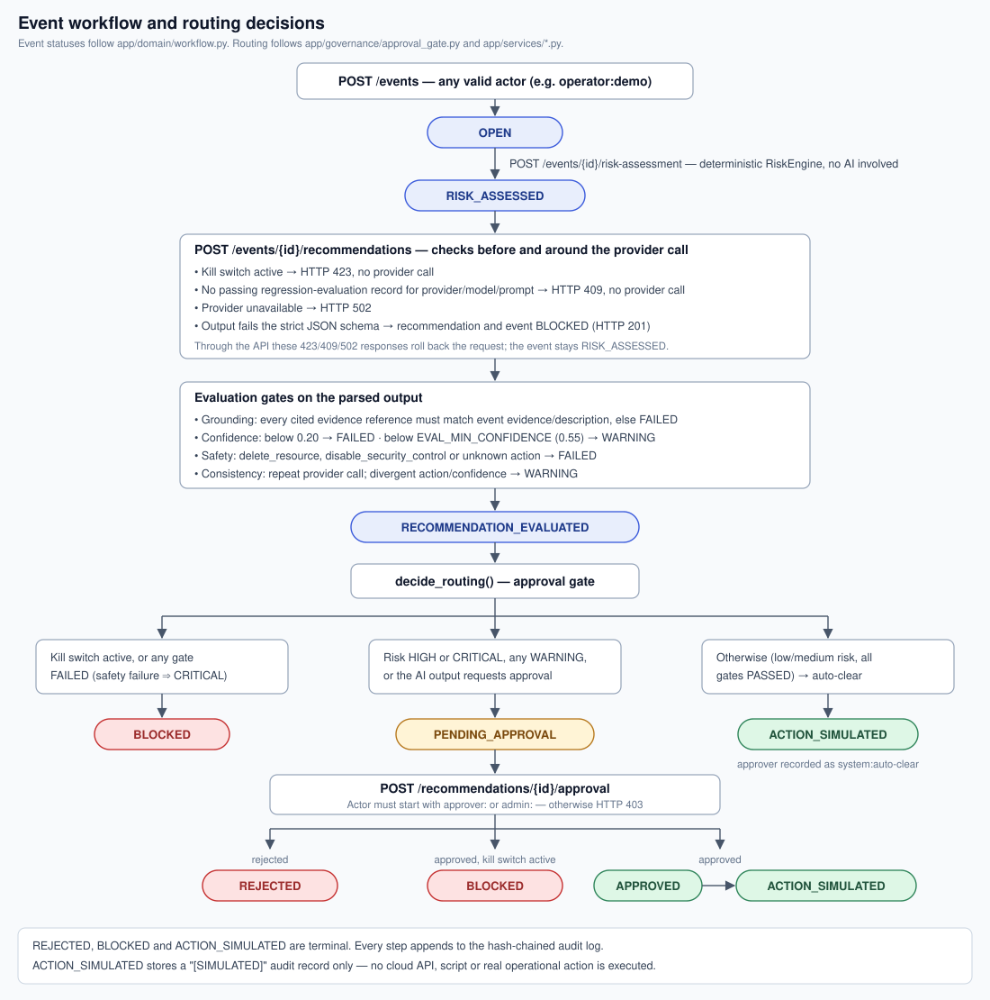

# Governance and Validation

What controls the system enforces, who may do what, how it was validated, and where it falls
short. Governance here means controls built into the code. This project has no
organizational process, certification, or compliance attestation behind it.

## Human oversight

- **The AI never acts.** Providers only return a proposal. The only "action" path,
  `simulate_action()`, returns a dictionary marked `"simulated": true` with a `[SIMULATED]`
  message and writes it to the audit log. No cloud SDK, shell command, or external call is
  made.
- **Humans decide at defined risk points.** `decide_routing()` requires human approval when
  the deterministic risk is high or critical, when any evaluation gate returns a warning
  (for example confidence below 0.55), or when the AI output itself asks for approval.
- **Auto-clear is narrow.** It applies only when risk is low or medium and every gate
  passed. It still creates an approval record (approver `system:auto-clear`) and audit
  entries, so the trail looks the same either way.
- **Failures block rather than escalate.** A failed gate (schema, grounding, confidence below
  0.20, or a dangerous or unknown action) blocks the recommendation. It never reaches an
  approver as a valid option.
- **Kill switch.** An `admin:` actor can stop all AI calls and all simulated actions. It is
  checked before the provider call, again before routing, at auto-clear, and at the moment of
  human approval. An approval given while the switch is active is recorded, but the event is
  blocked.
- **Provider changes need evidence.** A provider/model/prompt combination is used only after
  a regression evaluation against the versioned dataset (`regression-v1`, four cases) passes
  100%.

## Authority boundaries

Identity is the self-declared `X-ArchGuard-Actor` header. The value must match
`^[a-zA-Z][a-zA-Z0-9_.:-]{1,127}$`, and the role is the prefix before the colon.

| Action | Who may do it |
| --- | --- |
| Read events, recommendations, evaluations, audit, kill-switch state, eligibility; dashboard; health and metrics | Anyone (no header required) |
| Create events, run risk assessment, request recommendations, run regression evaluation | Any valid actor |
| Approve or reject a recommendation | Actors starting with `approver:` or `admin:` (otherwise HTTP 403) |
| Activate or deactivate the kill switch | Actors starting with `admin:` (otherwise HTTP 403) |
| Execute a real operational action | Nobody. Not implemented |

The deterministic risk engine, not the AI, decides the risk level. The AI can only make the
classification stricter: a safety failure raises it to critical. It cannot lower it.

## Security and privacy controls

| Control | Implementation |
| --- | --- |
| Input validation | Pydantic request models with `extra="forbid"`, enum-constrained fields, length limits (4000 characters for text, 256 for short fields, at most 20 evidence items). Invalid payloads return a generic 422 |
| Untrusted AI output | Strict output schema (`extra="forbid"`, confidence bounded 0–1) before any other check runs |
| Error hygiene | Unhandled exceptions return only `internal_error` plus a correlation ID; domain errors return their own message, with no stack traces or SQL |
| Injection handling | SQLAlchemy parameterized queries; Jinja2 autoescaping in the dashboard. Tests cover SQL- and script-shaped input being stored literally |
| Secrets | `.env` is git-ignored; `.env.example` holds placeholders only (checked by a test); the optional API key is read from the environment and sent only as a bearer header |
| Logging | JSON logs with correlation IDs; values under keys such as `password`, `api_key`, `token`, `authorization` are redacted |
| Container | Non-root user (`uid 1000`), slim base image, healthcheck; the build verifies TLS by default, and skipping verification is an explicit opt-in build argument |
| Data | Seed and test data are synthetic. No personal or production data is used or required |
| Audit integrity | Each audit row stores a SHA-256 hash over the previous hash and its own content. `GET /audit/verify` replays the chain |
| Cloud design (not deployed) | Secrets in Secrets Manager / Secret Manager, private RDS (`publicly_accessible = false`), scoped IAM roles. POC-only exceptions are commented in the Terraform |

## Validation approach

- **Pure logic is unit-tested without a database:** risk engine, state machine, routing
  policy, evaluation gates, mock provider, identity rules, kill switch, logging redaction,
  health.
- **Persistence is tested against real PostgreSQL, never SQLite:** migrations up and down,
  repositories, check constraints, cascade delete, audit hash chain and tamper detection,
  transaction rollback.
- **API, security, and end-to-end tests** drive the FastAPI app through `TestClient` on a
  real database: each AI-assurance failure path, authorization rules, dangerous-action
  blocking, input validation, secret exposure, and two full workflows (human approval, and
  fail-closed with the kill switch).
- **CI** (`.github/workflows/ci.yml`) runs ruff, migrations, all suites against a PostgreSQL
  16 service, a Docker build, and Terraform static checks for both clouds.
- **Manual verification** for this documentation: the Docker stack was built, migrated,
  seeded, and exercised with the demo in [DEMO_AND_OPERATIONS.md](DEMO_AND_OPERATIONS.md),
  and the dashboard screenshots were taken from that running stack.

## Test execution status

Run on 2026-10-25 on Windows with Python 3.12.10, against PostgreSQL 16 in Docker:

| Check | Tests | Result |
| --- | --- | --- |
| `ruff check app tests migrations seed` | — | Passed |
| `ruff format --check app tests migrations seed` | — | Passed (93 files) |
| `pytest tests/unit` | 61 | 61 passed |
| `pytest tests/integration` | 12 | Passed |
| `pytest tests/api` | 35 | Passed |
| `pytest tests/security` | 19 | Passed |
| `pytest tests/e2e` | 2 | Passed |
| DB-backed suites combined | 68 | 68 passed, 0 skipped |
| Docker image build | — | Passed, using the documented TLS opt-in required on this network |
| Alembic `upgrade head` + seed script | — | Passed; eligibility pass rate 1.00, five events seeded |
| `GET /audit/verify` after the demo | — | `chain_intact: true` |
| `terraform fmt -check` (AWS, GCP) | — | Passed |
| `terraform init` / `validate` (AWS, GCP) | — | **Not run locally**: the registry was unreachable from this network. Both passed in CI run 34834370105 for the current code (commit `0fa8d9c`) |

Not tested anywhere: the OpenAI-compatible provider against a real endpoint, any cloud
deployment, load or concurrency behavior.

## Known limitations

- **Blocked-path writes are rolled back through the API.** When a recommendation request
  ends in HTTP 423 (kill switch), 409 (provider not eligible), or 502 (provider unavailable),
  the service writes an audit entry, and for 423 and 502 a `blocked` status, and then raises.
  The request-scoped session rolls back on any exception, so through the HTTP API none of
  those writes are kept and the event stays `risk_assessed`. This was confirmed on the
  running stack for 423 and 502. The workflow still does not advance, so the result is fail
  closed, but the attempt is not recorded in the audit log. The API tests do not detect this
  because their session fixture does not commit or roll back. The seed script records the
  provider-failure case as `blocked` because it catches the exception inside its own
  session.
- **Identity is not authentication.** Any client can claim `admin:anyone`. Role prefixes
  only demonstrate where authorization checks would sit.
- **Read endpoints are open.** Audit details, recommendations, and the dashboard require no
  identity.
- **The audit chain is tamper-evident, not tamper-proof.** Someone with write access to the
  table can recompute every hash. Appends read the latest row and then insert, which is not
  designed for concurrent writers (not tested).
- **The evaluation gates are heuristics.** Grounding is substring matching, consistency is
  one repeat call, and the confidence value is whatever the provider reports.
- **The default AI is a mock.** Results show the control flow, not model quality.
- **Optional provider gaps.** The OpenAI-compatible provider is untested. Its
  `MalformedProviderResponseError` (unparseable reply) is not handled like a schema failure;
  it surfaces as HTTP 502 without a stored recommendation.
- **Regression eligibility is keyed by labels.** `POST /providers/regression-evaluation`
  accepts an optional `model_name` / `prompt_version`, but always evaluates the configured
  provider instance. The dataset has four cases.
- **Some settings are inert.** `APP_HOST`, `APP_PORT`, `APPROVAL_HEADER_NAME`,
  `KILL_SWITCH_DEFAULT_STATE`, and `METRICS_ENABLED` are loaded but not used.
- **Metrics are per-process and in memory.** They reset on restart.
- **The Terraform is a reference only,** with POC-only network exposure, and has never been
  applied.

## Focused future improvements

1. Persist blocked outcomes and their audit entries before returning the error (for example
   by committing them separately or returning a structured blocked result instead of
   raising), and add an API test that uses the real commit/rollback session.
2. Replace the actor header with real authentication (OIDC/JWT) and map roles from claims;
   protect read endpoints.
3. Serialize audit appends (row lock or advisory lock) and anchor the chain head outside the
   database.
4. Handle `MalformedProviderResponseError` like a schema failure, and add contract tests for
   the OpenAI-compatible provider against a stub server.
5. Grow the regression dataset and tie eligibility to the provider actually evaluated.
6. Wire or remove the inert settings.
